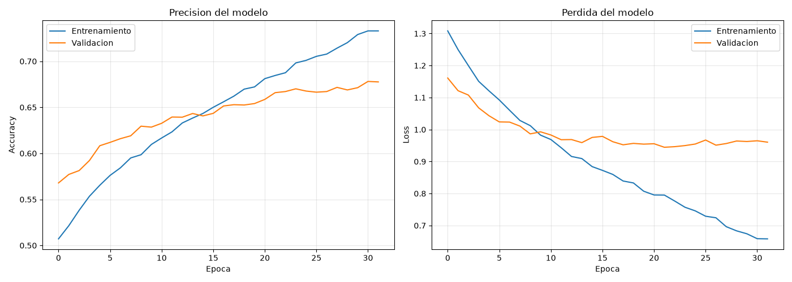
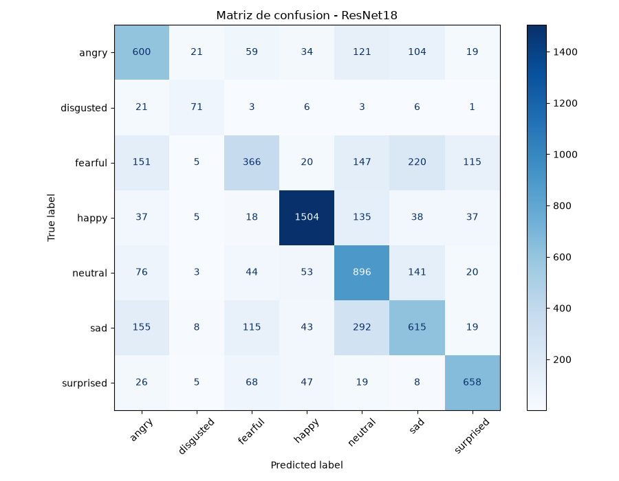

# Práctica 5. Biometría: detección y caracterización de caras

## Descripción

En esta práctica trabajamos con la detección y el análisis de caras, manos y cuerpo para desarrollar dos filtros interactivos. Para ello utilizamos MediaPipe para obtener los landmarks, OpenCV para procesar los fotogramas y dibujar los elementos gráficos, y un modelo ResNet18 entrenado para reconocer expresiones faciales.

Los dos prototipos desarrollados son un filtro del Oeste y un sable láser que sigue el movimiento de la mano y cambia de color según la expresión facial detectada.

### Autores
- Pablo Llopis Parrilla (@Putrici0)
- David González Espino (@002avid)

-----
Falta la guía de instalación

- pip install -q kagglehub torch torchvision
-----

## Tarea 1. Filtro del Oeste

El primer prototipo consiste en un filtro inspirado en las películas del Oeste. Utilizamos MediaPipe para detectar la cara, las manos y el cuerpo, y así poder colocar los accesorios en la posición correspondiente.

Para ello se utilizan tres modelos de MediaPipe:

- **Face Landmarker:** detecta los puntos de referencia de la cara. Se utiliza para calcular la posición, tamaño e inclinación del sombrero y para localizar la boca.
- **Pose Landmarker:** obtiene los puntos del cuerpo, principalmente los hombros. Con ellos calculamos la posición, anchura e inclinación de la bandana.
- **Hand Landmarker:** detecta las manos y permite interactuar con el puro.

Los accesorios utilizados son un sombrero, una bandana y un puro. Se cargan como imágenes PNG y se superponen sobre la imagen de la cámara. Para colocarlos se calcula su tamaño en función de las dimensiones de la cara o de los hombros. También se tiene en cuenta la inclinación para que los accesorios acompañen el movimiento de la persona.

La superposición se realiza teniendo en cuenta el canal alfa de las imágenes, de forma que se conserva la transparencia. Además, se recorta el accesorio cuando parte de él queda fuera de los límites del fotograma.

### Interacción con el puro

El puro comienza colocado junto a la boca. Para recogerlo se utiliza la posición del punto medio entre el pulgar y el índice de la mano detectada. Se calcula la distancia entre ese punto y la posición del puro.

El comportamiento se controla mediante dos estados:

- **En la boca:** si la mano permanece cerca del puro durante aproximadamente 0,9 segundos, se considera que la persona lo ha cogido y el puro pasa a la mano.
- **En la mano:** cuando la mano se aleja de la boca y posteriormente vuelve a acercarse, el puro se devuelve a su posición inicial después de aproximadamente 0,3 segundos.

De esta forma evitamos que el puro cambie de posición por una detección puntual de la mano.

### Efecto visual

Una vez colocados los accesorios, aplicamos un filtro a cada fotograma para darle un aspecto antiguo:

- **Sepia:** se utiliza una matriz de transformación de color para conseguir el tono característico.
- **Contraste y brillo:** se ajustan ligeramente para mejorar el aspecto de la imagen.
- **Viñeteado:** se oscurecen progresivamente las esquinas mediante una máscara gaussiana.
- **Grano:** se añade ruido aleatorio para simular el aspecto de una película antigua.

El resultado se muestra en tiempo real desde la cámara. Se puede salir pulsando la tecla `ESC`.

## Tarea 2. Sable láser controlado por la mano y las expresiones faciales

El segundo prototipo consiste en un sable láser que sigue la posición de la mano. Además, el color de la hoja cambia según la expresión facial que reconoce el modelo entrenado.

En este prototipo combinamos MediaPipe Hand Landmarker, un detector facial de OpenCV y el modelo ResNet18 entrenado con el conjunto de datos FER.

### Seguimiento de la mano y dibujo del sable

Utilizamos **MediaPipe Hand Landmarker** para obtener los landmarks de hasta dos manos. Para colocar la empuñadura se calcula una posición aproximada de la palma utilizando la muñeca y el nudillo del dedo corazón.

Para mantener el seguimiento de la misma mano entre fotogramas, se compara su posición con la del fotograma anterior y se selecciona la detección más cercana.

La orientación del sable se calcula a partir de los nudillos del dedo índice y del meñique. Con sus coordenadas se obtiene un vector tridimensional y se proyecta sobre la imagen para calcular la dirección de la empuñadura y de la hoja.

La empuñadura se dibuja con líneas y círculos de OpenCV, utilizando distintos grosores y colores para representar las partes metálicas y los detalles. La hoja se genera también mediante OpenCV:

- Se dibuja una línea exterior más gruesa sobre una capa independiente.
- Se aplica un desenfoque gaussiano para crear el resplandor.
- Se mezcla esa capa con el fotograma original.
- Se dibuja encima una línea más estrecha del color del sable y un núcleo blanco.

Así conseguimos el efecto luminoso de la hoja.

### Detección y clasificación de expresiones faciales

Para reconocer la expresión facial se carga el modelo **ResNet18** entrenado previamente. También se carga el fichero `clases.json`, que contiene el orden de las siete categorías utilizadas durante el entrenamiento.

Primero se detecta la cara mediante el clasificador Haar Cascade de OpenCV (`haarcascade_frontalface_default.xml`). Si aparecen varias caras, se selecciona la de mayor tamaño.

La región facial se recorta, se convierte a escala de grises y después se vuelve a convertir a tres canales para adaptarla a la entrada de ResNet18. A continuación:

1. Se redimensiona la cara a 224 × 224 píxeles.
2. Se convierte a tensor.
3. Se normaliza utilizando los valores de media y desviación estándar de ImageNet.
4. Se introduce en ResNet18 y se obtiene la clase con mayor puntuación.

La clasificación se actualiza cada 0,5 segundos para no tener que ejecutar la red en todos los fotogramas.

### Cambio de color del sable

Según la expresión reconocida, se actualiza el color de la hoja. En el código actual se han definido estas correspondencias:

| Expresión | Color del sable |
|---|---|
| `angry` | Rojo |
| `happy` | Verde |
| `sad` | Azul |
| `neutral` | Morado |

El modelo reconoce las siete clases del conjunto de datos, aunque en esta versión solo se han asignado colores a esas cuatro expresiones. Cuando se detecta una de ellas, el color del sable se actualiza y se mantiene hasta la siguiente predicción que tenga un color asociado.

El resultado combina el seguimiento de la mano con la clasificación facial: la posición y orientación del sable dependen de la mano, mientras que el color depende de la expresión detectada.

## Entrenamiento del modelo de expresiones faciales

Para el reconocimiento de expresiones utilizamos **ResNet18 preentrenada con ImageNet**, adaptando su última capa al problema de clasificación de siete expresiones faciales. El entrenamiento se realiza con PyTorch y TorchVision.

### Conjunto de datos

Utilizamos el dataset [Emotion Detection FER de Kaggle](https://www.kaggle.com/datasets/ananthu017/emotion-detection-fer), basado en FER2013. Contiene imágenes de caras de 48 × 48 píxeles organizadas en siete clases:

- `angry`
- `disgusted`
- `fearful`
- `happy`
- `neutral`
- `sad`
- `surprised`

La descarga se realiza mediante `kagglehub`. El dataset ya incluye una carpeta de entrenamiento y otra de test. Conservamos el test original y dividimos las imágenes de entrenamiento por clase, utilizando un 80 % para entrenamiento y un 20 % para validación. La separación se realiza con una semilla fija para que pueda repetirse.

La distribución que utilizamos queda así:

| Conjunto | Número de imágenes |
|---|---:|
| Entrenamiento | 22.965 |
| Validación | 5.744 |
| Test | 7.178 |

### Preparación de las imágenes

ResNet18 espera imágenes de tres canales y utiliza una entrada de 224 × 224 píxeles. Por eso, durante el entrenamiento las imágenes se redimensionan a ese tamaño y se normalizan con la media y desviación estándar de ImageNet.

En el conjunto de entrenamiento se aplican transformaciones para variar ligeramente las imágenes y evitar que la red dependa siempre de la misma posición:

- Recortes y cambios de escala.
- Volteo horizontal.
- Pequeñas rotaciones.
- Traslaciones.

En validación y test no se aplican estas modificaciones aleatorias. Únicamente se redimensionan y normalizan las imágenes.

También se calculan pesos para las clases a partir de la cantidad de imágenes de cada una. Estos pesos se utilizan en la función de pérdida para compensar el desequilibrio del conjunto de datos.

### ResNet18 y entrenamiento

Cargamos ResNet18 con los pesos preentrenados de ImageNet. Sustituimos su clasificador original por una nueva cabeza adaptada a las siete expresiones:

- Dropout de 0,5.
- Capa lineal de 512 a 256 neuronas.
- Activación ReLU.
- Dropout de 0,4.
- Capa final de 7 neuronas, una por cada expresión.

El entrenamiento se divide en dos fases:

**1. Transfer Learning**

En la primera fase congelamos los parámetros originales de ResNet18, de forma que no se modifican sus filtros. Solo entrenamos la nueva cabeza clasificadora para adaptarla a nuestras siete categorías.

Se configura un máximo de 10 épocas y se utiliza AdamW con un learning rate de 0,001 para la cabeza.

**2. Fine-tuning**

En la segunda fase descongelamos todas las capas de ResNet18. De esta forma, además de entrenar el clasificador, permitimos que los filtros originales se adapten a las características de las expresiones faciales del dataset.

Se configura un máximo de 40 épocas. Utilizamos dos learning rates: 0,00001 para el backbone y 0,0001 para la cabeza clasificadora.

En ambas fases se utiliza la pérdida `CrossEntropyLoss` con los pesos de las clases. También se emplean:

- **AdamW:** optimizador utilizado para actualizar los pesos.
- **ReduceLROnPlateau:** reduce el learning rate cuando la pérdida de validación deja de mejorar.
- **Early Stopping:** detiene el entrenamiento si la pérdida de validación no mejora durante 10 épocas.
- **Model Checkpoint:** guarda los pesos del modelo que obtiene la mejor pérdida de validación.

El entrenamiento utiliza CUDA cuando está disponible, por lo que puede aprovechar la GPU para acelerar el proceso.

### Evaluación y gráficas

Una vez terminado el entrenamiento, recuperamos el mejor modelo guardado durante la validación y lo evaluamos con el conjunto de test, que no se ha utilizado para actualizar los pesos.

Se generan métricas de evaluación, un informe de clasificación con `precision`, `recall` y `F1-score` para cada expresión, y una matriz de confusión. La exactitud obtenida sobre test es aproximadamente del **65,6 %**.

#### Gráficas de entrenamiento



En la gráfica de la izquierda se representa el **accuracy** de entrenamiento y validación a lo largo de las épocas. Se observa que ambos mejoran inicialmente, pero sus resultados empiezan a separarse a medida que avanza el entrenamiento. Al final, el accuracy de entrenamiento alcanza aproximadamente el 73 %, mientras que el de validación se queda cerca del 68 %.

En la gráfica de la derecha se representa la **pérdida (loss)** de ambos conjuntos. La pérdida de entrenamiento continúa disminuyendo, mientras que la de validación deja de mejorar claramente y se mantiene alrededor de 0,95. Esta diferencia entre ambas curvas indica que aparecen signos de **sobreajuste**: el modelo sigue aprendiendo las imágenes de entrenamiento, pero no consigue mejorar en la misma medida con imágenes que no ha utilizado para aprender.

#### Matriz de confusión



La matriz de confusión permite analizar qué expresiones reconoce correctamente el modelo y cuáles tiende a confundir. La diagonal principal representa las predicciones correctas, mientras que los valores fuera de ella indican clasificaciones equivocadas.

Se observa que las expresiones **happy** y **surprised** son de las que mejor reconoce, con un 84,8 % y un 79,2 % de aciertos respectivamente. En cambio, **fearful** es la más difícil de identificar, con aproximadamente un 35,7 % de aciertos. Esta expresión se confunde especialmente con `sad`, `angry` y `neutral`.

También destaca la confusión entre `sad` y `neutral`: 292 imágenes de la clase `sad` se clasificaron como `neutral`.

En general, la matriz permite comprobar que el rendimiento no es igual para todas las expresiones y que algunas presentan más dificultades de clasificación que otras.

## Instalación y ejecución

Para preparar el entorno, se deben seguir las instrucciones del [README — Guía Práctica 5](https://github.com/otsedom/otsedom.github.io/blob/main/VC/P5/README.md).

Además, nuestro código necesita instalar algunas librerías adicionales:

```bash
pip install torch torchvision kagglehub Pillow
```

El notebook principal es `VC_P5.ipynb`. Sus celdas deben ejecutarse en orden. Los modelos de MediaPipe y ResNet18 necesarios se encuentran incluidos en el repositorio.

Los prototipos utilizan la cámara web. Para cerrar cada ejecución se pulsa `ESC`.

## Archivos principales del repositorio

```text
VC_P5/
├── VC_P5.ipynb
├── accesorios/
│   ├── sombrero.png
│   ├── puro.png
│   └── bandadna.png
├── models/
│   └── resnet18_reanudacion_1/
│       ├── modelo_resnet18_final.pth
│       ├── clases.json
│       ├── graficas_entrenamiento.png
│       └── matriz_confusion.png
├── face_landmarker.task
├── hand_landmarker.task
└── pose_landmarker_lite.task
```

- `VC_P5.ipynb`: notebook con los dos prototipos y el entrenamiento y evaluación del modelo de expresiones faciales.
- `accesorios/`: imágenes utilizadas en el filtro del Oeste.
- `models/resnet18_reanudacion_1/`: pesos del modelo ResNet18, clases y resultados gráficos del entrenamiento.
- `face_landmarker.task`, `hand_landmarker.task` y `pose_landmarker_lite.task`: modelos utilizados por MediaPipe.

El dataset completo no se incluye en el repositorio. Se descarga desde Kaggle cuando se ejecutan las celdas correspondientes.

## Referencias

- [README de la Práctica 5](https://github.com/otsedom/otsedom.github.io/blob/main/VC/P5/README.md)
- [Emotion Detection FER — Kaggle](https://www.kaggle.com/datasets/ananthu017/emotion-detection-fer)
- [MediaPipe](https://developers.google.com/mediapipe)
- [Face Landmarker](https://ai.google.dev/edge/mediapipe/solutions/vision/face_landmarker)
- [Hand Landmarker](https://ai.google.dev/edge/mediapipe/solutions/vision/hand_landmarker)
- [Pose Landmarker](https://ai.google.dev/edge/mediapipe/solutions/vision/pose_landmarker)
- [PyTorch](https://pytorch.org/)
- [TorchVision — ResNet18](https://docs.pytorch.org/vision/stable/models/generated/torchvision.models.resnet18.html)
- [ChatGPT](https://chatgpt.com/): utilizado para encontrar los landmarker de MediaPipe que se utilizaron, asistiendo al código. Además, de revisión de errores gramaticales y ortográficos en este documento.